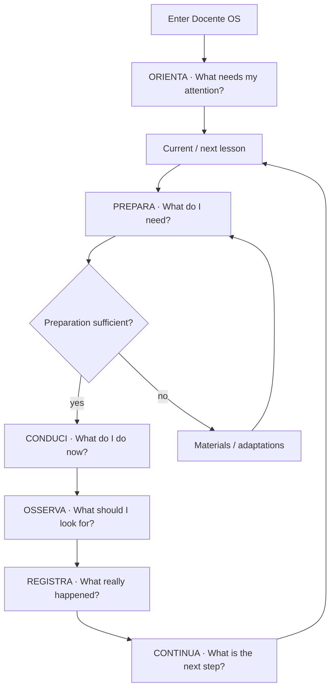
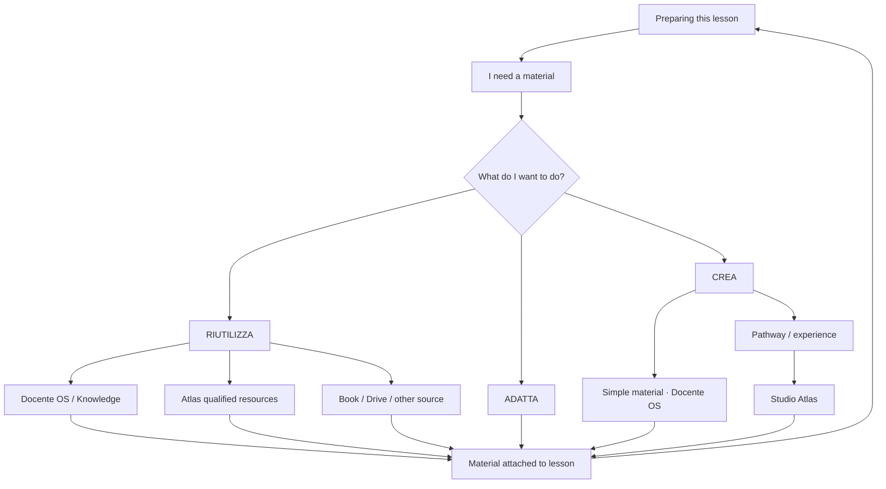
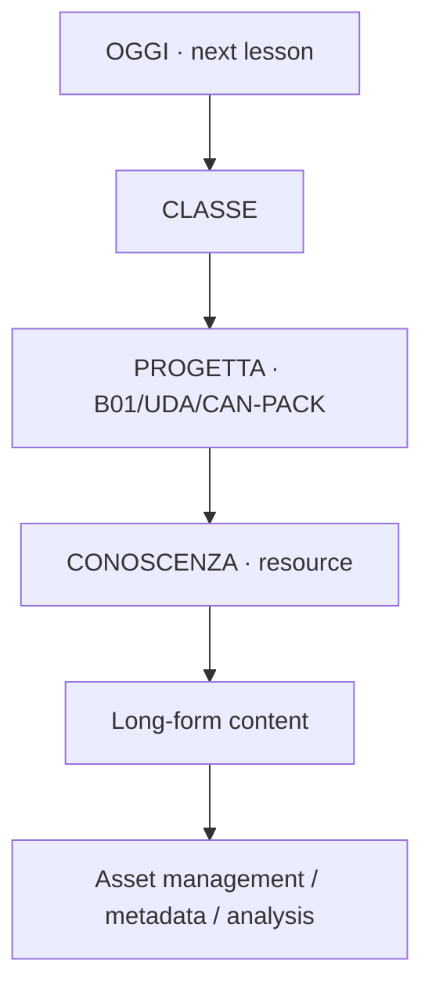
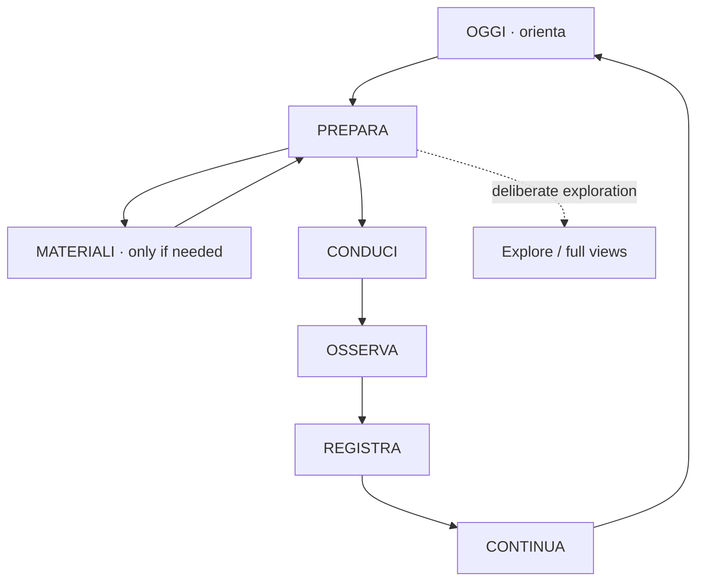

# DOCENTE OS — Task-Centric Flow Architecture

**Status:** DESIGN APPROVED / SPEC FOR HUMAN REVIEW  
**Date:** 2026-10-18  
**Baseline:** `develop@692dcce6b6b2d75c45780d147118f6436a6704d7`  
**Scope:** UX architecture, interaction architecture, task continuity, view contracts, Docente OS ↔ Atlas/Studio Atlas boundary  
**Runtime:** NO PRODUCT CHANGE AUTHORIZED BY THIS SPEC

## 1. Why this specification exists

The DOS-CLOSE-02 Human Review on the Beta showed that the product is technically functional but the professional journey is still cognitively fragmented.

Observed user evidence:

- the teacher could move from `Oggi` to a class, then to `Progetta`, then to `Conoscenza`, then to long-form material;
- each transition exposed a new product/domain identity although the human intent had not changed;
- existing materials remained dominant and Atlas was not clearly present as a useful capability;
- the user had to understand internal surfaces to complete a simple professional objective;
- the overall experience felt complicated even after J1 engineering qualification.

This specification does **not** add a new product model. It makes the already-canonical Human Task Model operational at UX architecture level.

Canonical references already present in the repository:

- `docs/architecture/HUMAN_TASK_MODEL.md`
- `docs/research/HUMAN_TASK_CONTENT_MODEL_RESEARCH.md`
- existing lesson workspace `prepare / teach / observe / record`
- existing task-continuity contract for Knowledge
- existing lesson material intents `Riutilizza / Adatta / Crea nuovo`

Cross-product references:

- TRAMA `TRAMA-ADR-020 — Studio Atlas product boundary`
- Studio Atlas Product Foundation v0.1

## 2. Product decision

### 2.1 Primary axis

The primary axis of Docente OS is the **current/next lesson and its professional cycle**.

The teacher-facing cycle is:

`ORIENTA → PREPARA → CONDUCI → OSSERVA → REGISTRA → CONTINUA`

`Classi`, `Progetta`, `Conoscenza`, `Piano annuale`, `Orario`, `Calendario`, `Atlas`, and `Studio Atlas` are not mandatory primary-flow stages. They are capabilities, authorities, sources, or exploratory environments invoked by the current task when necessary.

### 2.2 Core architectural principle

> The user graph and the software-domain graph must not be isomorphic.

Internally Docente OS may traverse Planner, Classes, Annual Plan, Knowledge, Arena, Atlas, Studio Atlas, Calendar and TeachingSession.

The teacher should normally experience:

`Adesso → Prepara → Insegna → Osserva → Registra → Continua`

The system traverses the domains on behalf of the user.

### 2.3 Selected design approach

**Task-centric UX over the existing domain architecture.**

Rejected as default:

- Navigation-first simplification only: preserves navigation tax and domain leakage.
- New monolithic lesson cockpit replacing existing domains: risks authority duplication and unnecessary reimplementation.

Selected approach keeps existing repositories, routes, authority boundaries and domain models while recomposing their presentation around the professional task.

---

## 3. Canonical Human Flow Graph



This graph is the primary product graph perceived by the teacher.

---

## 4. Real use cases that govern the design

The product must be designed from real work situations, not from site sections.

### UC1 — Prepare tomorrow's lesson

Situation: evening, weekend or non-teaching time.

Human question: **What must I prepare for my next lesson?**

Target flow:

`Oggi → Prepara`

No mandatory traversal through `Classi → Progetta → Conoscenza`.

### UC2 — I enter class in five minutes

Situation: immediately before a lesson.

Human questions:

- Do I have everything?
- What do I do first?

Target flow:

`Oggi → Prepara → Inizia lezione`

The existing Human Task Content Model acceptance budget applies: identify the lesson rapidly, reach preparation directly, find student-facing material without search.

### UC3 — I need a material

Situation: lesson preparation.

Human question: **What do I already have, and can I reuse or adapt it?**

Target flow:

`Prepara → Materiali`

Material source is provenance, not navigation structure.

### UC4 — The material I need does not exist

Target flow:

`Prepara → Materiali → Crea`

Two distinct intents:

- simple teaching material → Docente OS;
- pathway/interactive experience → Studio Atlas, when the governed handoff is actually available.

### UC5 — I am teaching now

Human question: **What do I do now with the class?**

Target view: `CONDUCI`.

The lesson behaves as a professional runbook, not a canonical document viewer.

### UC6 — I need to observe/assess

Human question: **What should I look for during this activity?**

Target view: `OSSERVA`.

Only relevant indicators and expected evidence are shown first. Full rubric stays behind progressive disclosure.

### UC7 — The lesson is finished

Human question: **What actually happened, and what comes next?**

Target flow:

`REGISTRA → CONTINUA`

### UC8 — The lesson was not completed as planned

Situation: slower class, interruption, recovery, replanning.

Target flow:

`REGISTRA → partial/remodelled/recovered → CONTINUA`

Continuity starts from the last recorded reality, not automatically from the next theoretical annual-plan block.

### UC9 — Non-lesson professional work

Situation: deadline, meeting, administrative/professional task.

This remains a secondary branch of `Oggi`, not a reason to overload the lesson flow.

### UC10 — Context cannot be determined safely

The system must not dump the user into product structure.

Wrong fallback:

`cannot resolve lesson → Classi → Progetta → user reconstructs context`

Target fallback:

- show the known class/time/last work;
- state that the exact next phase is uncertain;
- offer a human action such as `Continua da qui` or `Scegli un'altra fase`;
- technical reason stays under details.

---

## 5. Materials Flow Graph



Rules:

- `Riutilizza / Adatta / Crea nuovo` is the teacher-facing intent model.
- Knowledge, Drive, textbooks and Atlas are sources.
- Provenance remains visible but does not define a separate journey.
- Studio Atlas appears only for authoring intents that justify a product boundary crossing.

---

## 6. Atlas and Studio Atlas boundary

### 6.1 Atlas in lesson preparation

A qualified Atlas object is presented as a lesson resource:

- human title;
- type;
- short relevance explanation;
- provenance badge `Atlas`;
- `Anteprima`;
- `Usa nella lezione`.

The teacher does not need to understand Atlas architecture in order to use the object.

### 6.2 Studio Atlas

Studio Atlas is not a generic navigation destination inside the ordinary lesson flow.

It is invoked by a deliberate authoring intent such as:

`Crea nuovo → Percorso / esperienza → Studio Atlas`

The governed direction remains:

`lesson/material seed → Studio Atlas → reusable stable reference → Docente OS lesson/material slot`

Docente OS remains authoritative for class, timetable, TeachingSession and teacher decision of use.

Studio Atlas remains authoritative for pathway authoring.

Atlas remains responsible for its reusable/public resource lifecycle.

### 6.3 Current maturity constraint

Do not present Atlas as a universal live catalogue until the general runtime binding actually exists.

The current Docente OS integration includes a specific ECO-02 pilot Atlas material; therefore Atlas UI must be `available when qualified`, not synthetically always available.

---

## 7. AS-IS → TO-BE View Graph

### 7.1 Current observed flow



Human intent stays constant while interface identity changes repeatedly. This is domain leakage plus navigation tax.

### 7.2 Target view graph



Continuous edges are the ordinary professional journey.

Dotted edges are explicit user-requested exploration.

---

## 8. Classification of existing surfaces

| Current surface | Decision | Target role |
| --- | --- | --- |
| Home `/` | REMOVE FROM PRIMARY FLOW | Reuse orchestration logic; avoid a second daily starting point |
| Oggi `/planner` | RECOMPOSE | Daily cockpit and default operational entry |
| Class list `/classi` | REMOVE FROM PRIMARY FLOW | Deliberate class selection only |
| Class workspace `/classi/:id` | RECOMPOSE | Longitudinal class continuity view, not mandatory waypoint |
| Lesson Prepare | RECOMPOSE / PROMOTE | Primary `PREPARA` node |
| Lesson Teach | KEEP / PROMOTE | `CONDUCI` |
| Lesson Observe | KEEP / PROMOTE | `OSSERVA` |
| Lesson Record | RECOMPOSE / PROMOTE | `REGISTRA` plus immediate continuity |
| Lesson materials | RECOMPOSE | Subtask of `PREPARA` |
| Progetta | REMOVE FROM PRIMARY FLOW | `EXPLORE` / intentional planning |
| Knowledge list | REMOVE FROM PRIMARY FLOW | Deliberate search/catalogue |
| Knowledge detail | DEMOTE | Full professional asset sheet only when requested |
| Knowledge task-aware mode | RECOMPOSE | Material viewer inside current task identity |
| Piano annuale | DEMOTE | Progress/review authority feeding task context |
| Orario | KEEP AS FALLBACK | Orientation/correction when temporal context is uncertain |
| Calendario | DEMOTE | Time organisation, not primary teaching flow |
| Atlas resource | KEEP WHEN QUALIFIED | Material source inside lesson preparation |
| General Atlas integration | NOT YET AVAILABLE | Do not imply universal runtime integration |
| Studio Atlas handoff | NOT YET AVAILABLE | Authoring handoff only after governed runtime binding |

---

## 9. Persistent Lesson Shell

Once a teacher enters the lesson cycle, the interface keeps a persistent professional frame.

Always visible:

- class;
- discipline;
- human lesson title;
- when;
- current professional phase;
- current status.

Example shell:

```text
3ª E · Tecnologia
Energia: forme e trasformazioni
Domani · 11:00–12:00

PREPARA → CONDUCI → OSSERVA → REGISTRA
---------------------------------------
current task content
```

The teacher must not lose lesson/class/task identity when opening a resource or crossing an internal domain boundary.

Technical codes such as `B01`, `CAN-PACK-*`, UUIDs, version identifiers and generation metadata stay behind progressive disclosure unless specifically needed for professional verification.

---

## 10. View contracts

### 10.1 OGGI

**Human question:** What needs my attention now?

Above the fold:

- human date;
- current/next lesson or genuinely urgent professional task;
- class + discipline;
- human lesson title;
- when;
- truthful continuity (`Riprendi il filo`) when supported;
- one primary CTA.

Primary CTA varies by deterministic state:

- `Prepara lezione`;
- `Continua la lezione`;
- `Registra la lezione`;
- `Riprendi`.

At most two secondary actions, e.g. timetable/calendar and a truly urgent non-lesson task.

Do not place class catalogue, materials catalogue, annual-plan overview, Progetta, Knowledge or weekly statistics above the fold.

### 10.2 PREPARA

**Human question:** What must be ready before class?

Above the fold:

- lesson shell;
- objective;
- essentials to prepare;
- materials readiness summary;
- adaptation indication if relevant;
- one primary CTA.

Primary CTA:

- `Lezione pronta`;
- `Approva e procedi` when governed approval is needed;
- `Inizia la lezione` when already ready.

Secondary actions:

- `Materiali`;
- `Adatta`.

`Vedi progettazione completa` contains long-form design, outcomes, UDA, annual-plan context, references and technical details.

Existing material-selection capability currently hidden under full design must be promoted to the main preparation task.

### 10.3 MATERIALI

**Human question:** What do I use in this lesson?

This is a `PREPARA` subtask, not a macro-section.

Persistent lesson identity stays visible.

First-level intent selector:

`RIUTILIZZA | ADATTA | CREA`

Material cards answer only:

- what is it;
- why relevant here;
- provenance;
- what can I do.

Primary actions per item:

- `Anteprima`;
- `Usa`.

### 10.4 Material viewer

**Human question:** Is this material suitable for the lesson?

The visible identity remains `PREPARA · <class> · <lesson>`, not `Conoscenza`.

Show:

- resource type and title;
- readable preview;
- short relevance/context if useful;
- `Usa nella lezione`;
- up to two secondary actions such as `Apri originale` and `Adatta`.

Hide from ordinary focused mode:

- processing state;
- reliability/generation internals;
- ingestion chunks;
- extraction workflow;
- generic task creation;
- asset version management;
- editable professional classification controls.

Those remain in Knowledge `EXPLORE`.

### 10.5 CONDUCI

**Human question:** What do I do now in class?

The lesson behaves like a segmented professional runbook.

Show:

- current step;
- approximate timing;
- instruction/prompt;
- selected material needed now;
- next step.

Do not show authoring, unused material catalogue, full UDA or general configuration.

### 10.6 OSSERVA

**Human question:** What should I look for?

Show only relevant indicators, expected evidence and a lightweight note affordance.

Full rubric/criteria stay under `Vedi criteri completi`.

Primary action depends on lesson state:

- `Torna alla lezione` while teaching;
- `Registra` when closing.

### 10.7 REGISTRA

**Human question:** What actually happened?

Must be fast.

First-level outcomes include the real execution states already supported by the product, e.g. completed/recovered/remodelled/partial/not performed as governed by the actual model.

Capture:

- what was done;
- real date/time when needed;
- evidence/note;
- next activity;
- adaptation/critical issue only when relevant.

Primary CTA: `Registra lezione`.

The annual plan does not overwrite reality; Docente OS reconciles recorded reality with planned progression.

### 10.8 CONTINUA

**Human question:** Where do I restart next time?

After recording, show:

- confirmation;
- what was actually completed;
- next activity/continuity;
- `Prepara la prossima`;
- secondary `Torna a Oggi`.

This continuity must feed the next Oggi/class preparation without manual reconstruction.

### 10.9 CLASSE

**Human question:** Where are we with this class?

Class is a longitudinal continuity workspace, not a corridor.

Show first:

- next lesson;
- last real outcome;
- next activity;
- primary `Prepara prossima lezione`;
- compact annual progression.

Recent materials, observations and full plan stay secondary.

### 10.10 PROGETTA

**Human question:** I deliberately want to work on planning, not simply prepare the next lesson.

Rich exploratory UI is valid here: UDA, annual planning, grade-level material, coverage, documents and adaptations.

Progetta must not remain an obligatory waypoint inside ordinary PREPARA.

### 10.11 CONOSCENZA

Two modes are explicitly different:

**EXPLORE** — search, filter, sources, material, documents, provenance, processing and management.

**FOCUSED** — when entered from PREPARE/TEACH, render a lesson-context material viewer and preserve exact return to the task.

### 10.12 ATLAS

When a qualified Atlas resource exists, show it as a material option with human relevance, preview and use action.

Do not expose Atlas publication architecture, governance workflow or internal product structure in ordinary lesson preparation.

---

## 11. Navigation architecture

### Outside a focused task

Recommended top-level mobile information architecture:

`Oggi | Classi | Orario | Altro`

Avoid duplicated daily starts such as separate Home and Oggi competing for the same professional intent.

### Inside the Lesson Shell

Lesson context dominates global navigation.

Primary orientation is:

`<class> · <lesson> · PREPARA/CONDUCI/OSSERVA/REGISTRA`

Global navigation becomes perceptually secondary and the teacher has an explicit `← Oggi` escape.

---

## 12. Noise budget for FOCUSED views

A focused task view must satisfy the following default budget:

- exactly **1 primary CTA**;
- maximum **2 secondary actions** at the same hierarchy level;
- **1 dominant professional object**;
- maximum **3–4 information blocks above the fold**;
- **0 technical identifiers** at first level;
- **0 mandatory domain-navigation transitions** to complete the task;
- **1 tap** to return to the previous task context;
- **1 progressive-disclosure entry** to full/detail view.

This is a product validation budget, not an aesthetic preference.

---

## 13. Error and ambiguity handling

Task-centric composition must remain fail-closed with respect to authority.

Rules:

1. Never invent class, lesson, material readiness or continuity.
2. If temporal/class authority is ambiguous, present the uncertainty in human terms and ask for one bounded choice.
3. Do not hide missing canonical context by sending the teacher through internal navigation.
4. Do not promote a provisional/generated object as qualified Atlas material unless its governed state allows use.
5. A failure in a subordinate domain must not erase the teacher's current task identity.
6. Full diagnostic details remain available by progressive disclosure.

---

## 14. What must not be built

This design explicitly rejects the following responses to the UX problem:

- a new macro-section for the lesson flow;
- a second materials library;
- a duplicate lesson model;
- a duplicate Atlas catalogue inside Docente OS;
- a universal Atlas button with no real qualified binding;
- a new CMS inside Docente OS;
- technical-code driven navigation;
- a forced rewrite of existing Classi, Knowledge, Progetta, Piano or lesson repositories;
- hiding canonical information completely rather than demoting it;
- turning Studio Atlas into the owner of class/lesson/TeachingSession state.

---

## 15. Reuse before build

The following existing capabilities should be assumed reusable unless the Gap Matrix proves otherwise:

- current/next lesson resolution;
- `TodayTeachingFocus`;
- Home daily/next-moment orchestration logic;
- class learning focus and continuity data;
- lesson workspace modes `prepare / teach / observe / record`;
- lesson preparation brief;
- preparation approval contract;
- task-aware Knowledge URLs and return continuity;
- `Riutilizza / Adatta / Crea nuovo` intent model;
- Knowledge and Atlas lesson material suggestion adapters;
- annual-plan execution/progress;
- TeachingSession recording;
- timetable/calendar authorities.

The goal is recomposition before new functionality.

---

## 16. Acceptance model

The redesigned flow is acceptable when a teacher can answer quickly, without understanding internal architecture:

- Where am I?
- What am I doing?
- What is the real current state?
- What should I do now?
- What comes next?
- How do I return to the exact task I was doing?

Canonical qualitative scenario:

> In five minutes I enter class. Using Docente OS, tell me what I have to do and prepare the lesson.

The flow fails if the teacher must:

- navigate through Classi, Progetta or Conoscenza merely because the software is structured that way;
- interpret CAN/B codes to orient themselves;
- manually search for the known lesson resource;
- read a long canonical document to discover the next action;
- lose class/lesson context when opening a material;
- understand whether a capability comes from Knowledge, Atlas, Drive or another internal domain before they can use it;
- reconstruct manually what happened in the previous lesson.

---

## 17. Approved design decisions captured from Human Review

The following decisions were explicitly approved during the 2026-10-18 UX/architecture review:

1. The lesson current/next professional cycle is the primary axis of Docente OS.
2. Classi, Progetta, Conoscenza and Atlas are lateral capabilities, not mandatory primary-flow stages.
3. Real use cases, including slower/remodelled classes and missing context, govern flow design.
4. The primary human graph is `Oggi → Prepara → Materiali when needed → Conduci → Osserva → Registra → Continua`.
5. A persistent Lesson Shell carries class, lesson and task identity across subordinate domains.
6. Material provenance is visible but must not become navigation architecture.
7. Atlas is shown only when a qualified resource is really available.
8. Studio Atlas is used for explicit pathway/experience authoring, not ordinary lesson navigation.
9. Focused views obey a strict noise budget and progressive disclosure.
10. Existing capabilities are recomposed before adding new functionality.

---

## 18. Next design artifact: Gap Matrix

No implementation plan should be written until the next analytical artifact is completed and reviewed.

The Gap Matrix will map each target capability/view to:

- **KEEP** — already correct;
- **RECOMPOSE** — capability exists but must be reassembled in task context;
- **DEMOTE** — remains available but no longer dominates the primary flow;
- **REMOVE FROM PRIMARY FLOW** — valid environment, not a mandatory stage;
- **NOT YET AVAILABLE** — must not be implied in UI;
- **MISSING** — genuinely absent capability, requiring later implementation design.

For each row the matrix must identify:

- current route/component/service;
- real user case served;
- authority/data source;
- reuse candidate;
- UI change required;
- architecture change, if any;
- risk of authority duplication;
- acceptance evidence required.

Only after the Gap Matrix and visual mockups are approved should a detailed implementation plan be authored.

---

## 19. Scope guard

This specification authorizes **analysis and design documentation only**.

It does not by itself authorize:

- runtime changes;
- navigation changes;
- schema changes;
- merge to `develop`;
- Beta deploy;
- Atlas runtime activation;
- Studio Atlas runtime handoff;
- DOS-A1 activation.

The next step is Human Review of this written specification, then the Gap Matrix, then visual mockups, then a separately approved implementation plan.
