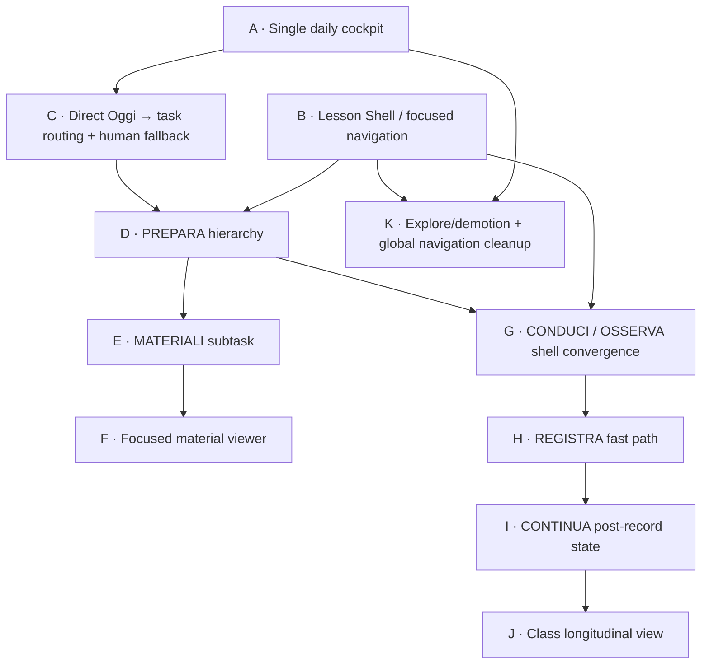

# DOCENTE OS — Task-Centric UX Gap Matrix

**Status:** ANALYSIS COMPLETE / HUMAN REVIEW REQUIRED  
**Date:** 2026-10-18  
**Baseline analysed:** `develop@692dcce6b6b2d75c45780d147118f6436a6704d7`  
**Parent design:** `docs/superpowers/specs/2026-10-18-docente-os-task-centric-flow-architecture-design.md`  
**Runtime:** NO PRODUCT CHANGE AUTHORIZED BY THIS MATRIX

## 1. Purpose

This matrix translates the approved task-centric UX architecture into a code-grounded AS-IS → TO-BE analysis.

It answers five questions before visual mockups or implementation planning:

1. what already exists and should be reused;
2. what exists but is presented at the wrong level;
3. what is genuinely missing;
4. what must be removed from the ordinary teacher flow without deleting the underlying capability;
5. what must remain a separate future programme rather than being pulled into the Docente OS UX closure.

The target professional cycle remains:

`ORIENTA → PREPARA → CONDUCI → OSSERVA → REGISTRA → CONTINUA`

The matrix is deliberately conservative: it prefers presentation recomposition over new domains, new stores or new authorities.

---

## 2. Executive finding

The main gap is **not missing business capability**. The main gap is **composition, hierarchy and task identity**.

Most of the target cycle already exists in production code:

- daily temporal context and next-lesson preparation;
- `prepare / teach / observe / record` lesson workspace modes;
- semantic lesson projections with objective, preparation, steps, resources, evidence, observation and continuation;
- lesson preparation approval;
- Knowledge task-continuity parameters;
- material intentions `Riutilizza / Adatta / Crea nuovo`;
- next-lesson and tomorrow material rendering;
- class task state including `PREPARE`, `TEACH`, `RECORD`, `CATCH_UP`, `AFTER_RECORD`;
- TeachingSession recording and `nextActivity` continuity;
- Atlas pilot material suggestion.

Therefore the target UX does **not** justify, by itself:

- a schema migration;
- a new lesson domain;
- a new materials store;
- a new curriculum authority;
- a new macro-section;
- a general Atlas catalogue;
- a Studio Atlas runtime activation.

The highest-value work is to make the existing task model visible and the internal domain model less visible.

---

## 3. Decision vocabulary

| Decision | Meaning |
| --- | --- |
| **KEEP** | Existing capability and presentation are already close to target. |
| **KEEP / PROMOTE** | Existing capability is strong but must become more central in the primary journey. |
| **RECOMPOSE** | Existing data/domain logic is reusable; presentation, hierarchy or routing must change. |
| **DEMOTE** | Capability remains available but must move behind progressive disclosure or explicit exploration. |
| **REMOVE FROM PRIMARY FLOW** | Keep the capability/route, but it must no longer be a mandatory waypoint. |
| **NEW PRESENTATION ONLY** | A missing user-facing state/view can be derived from existing authoritative data; no new domain is indicated. |
| **NOT YET AVAILABLE** | Do not simulate or imply availability. Requires a separately governed capability/runtime programme. |
| **NO CHANGE** | Existing role is already correct for the approved architecture. |

Priority vocabulary:

- **P0** — necessary to make the ordinary lesson journey coherent;
- **P1** — necessary to complete continuity and longitudinal use;
- **P2** — simplification/demotion after primary journey works;
- **SEPARATE** — not part of this UX closure.

---

## 4. Core architecture matrix

| Area | AS-IS evidence | TO-BE requirement | Decision | Gap type | Priority |
| --- | --- | --- | --- | --- | --- |
| Daily entry | `/` and `/planner` both orchestrate daily work | One clear operational starting point: `Oggi` | RECOMPOSE | Information architecture | P0 |
| Daily orchestration | Home already resolves lesson/task/registration/next moment; Oggi has operational loader and next preparation | One shared teacher-first daily decision model | REUSE + RECOMPOSE | Presentation/service convergence | P0 |
| Lesson context | Canonical lesson workspace already owns `prepare/teach/observe/record` | Make this the primary cycle once lesson is known | KEEP / PROMOTE | Journey hierarchy | P0 |
| Focused navigation | `AppShell` always exposes full global navigation and domain identity | Persistent Lesson Shell; global nav perceptually secondary during task | NEW PRESENTATION ONLY | Shell/presentation | P0 |
| Class continuity | Class page already resolves current task, next block, materials, sessions and after-record state | Longitudinal class view, not mandatory waypoint | RECOMPOSE | Presentation hierarchy | P1 |
| Planning | Progetta has broad and guided modes; can expose UDA/block/pack and Knowledge links | Intentional `EXPLORE`, not ordinary PREPARE waypoint | REMOVE FROM PRIMARY FLOW | Routing/IA | P2 |
| Knowledge | Generic asset management plus task-aware mode | EXPLORE when opened directly; lesson/material viewer when opened from task | RECOMPOSE | Task identity | P0 |
| Annual Plan | Authoritative progression/review surface | Feed task state; remain explicit review/explore surface | DEMOTE | Hierarchy | P2 |
| Timetable | Temporal orientation and ambiguity resolution | Fallback/orientation when lesson context uncertain | KEEP | None | P1 |
| Calendar | Real-day/event authority | Time authority, not ordinary lesson navigation | DEMOTE | Hierarchy | P2 |
| Atlas | Specific ECO-02 pilot suggestion only | Qualified resource when available | KEEP WHEN QUALIFIED | Availability boundary | P1 |
| Studio Atlas | Product boundary exists but lesson handoff runtime is deferred | Deliberate authoring handoff only when governed runtime exists | NOT YET AVAILABLE | Cross-product runtime | SEPARATE |

---

## 5. OGGI / daily cockpit

### Existing assets to reuse

- `product/src/app/api/assistant/today-context-loader.ts`
  - projected day;
  - real local clock;
  - planner tasks;
  - timetable/calendar authority;
  - session state;
  - current/nearest upcoming preparation within bounded lookahead.
- `product/src/core/presentation/today-teaching-focus.ts`
  - current/next lesson state;
  - human date label;
  - class/discipline/title;
  - readiness chips;
  - continuity.
- `product/src/app/planner/today-teaching-focus-card.tsx`
  - already close to the approved card contract.
- `product/src/app/page.tsx`
  - useful orchestration logic for current lesson, pending registration, priority task and next teacher moment.

### Gap matrix

| AS-IS | Problem | TO-BE | Decision |
| --- | --- | --- | --- |
| Home and Oggi are both first-level mobile destinations | Duplicate mental start point | One operational daily cockpit | RECOMPOSE |
| Home resolves rich daily priority; Oggi separately resolves teaching focus | Parallel orchestration risks inconsistent priorities | Shared presentation decision or common loader/presenter | REUSE / CONSOLIDATE |
| Oggi can fall back to `Apri la classe` | Safe technically, but exposes domain structure when task resolution fails | Task-language fallback retaining known context | RECOMPOSE |
| Oggi shows quick-domain actions and lower planner/timeline sections | Useful, but can compete with the lesson task | Primary task first; rest of day below progressive disclosure | DEMOTE |

### True missing capability

No new daily-data domain is indicated. The missing capability is a **single authoritative presentation decision for the daily cockpit**.

---

## 6. Persistent Lesson Shell

### AS-IS

All lesson modes are already routed through:

`/classi/[sectionId]/lezioni/[blockId]?mode=prepare|teach|observe|record`

but they are wrapped in the ordinary `AppShell`, which continues to display domain-level global navigation. Individual mode components repeat their own back links, headers and class identity.

### TO-BE

A focused lesson frame should preserve:

- class;
- discipline;
- human lesson title;
- date/time when applicable;
- professional phase;
- status;
- predictable return to `Oggi`.

### Decision

**NEW PRESENTATION ONLY / P0.**

No new lesson identity or persistent lesson entity is required. The shell can be derived from section, block, projection, temporal context and existing state.

### Open design question for mockups

Whether the phase rail is always visible on mobile or collapses to a compact current-phase indicator is a visual decision, not an architecture decision.

---

## 7. PREPARA

### Existing assets to reuse

`lesson-prepare-client.tsx` already contains:

- human lesson title;
- objective;
- duration;
- UDA progress;
- `Ti serve`;
- `Pronto da usare`;
- governed preparation approval;
- direct transition to TEACH.

`LessonDesignTools` already contains:

- `Riutilizza`;
- `Adatta`;
- `Crea nuovo`;
- Knowledge suggestions;
- Atlas suggestions;
- accepted materials;
- proposal lifecycle.

### Primary gap

The useful material task is currently nested inside **`Vedi progettazione completa`**, together with broader authoring tools, sequence additions and replanning. This reverses the approved hierarchy.

### TO-BE

Above the fold:

- lesson shell;
- objective;
- essentials;
- material readiness;
- one primary CTA;
- Materiali / Adatta as secondary task actions.

Full design and broader authoring remain in progressive disclosure / intentional Progetta.

### Decision

**RECOMPOSE / P0.**

The evidence points to extraction/recomposition of the existing materials subtask, not creation of a new material domain.

---

## 8. MATERIALI

### Existing assets to reuse

There are two mature but currently separated material capabilities:

1. `LessonDesignTools`
   - discover/reuse Knowledge and qualified Atlas resources;
   - adapt/create intent;
   - attach accepted resources to the lesson.
2. `/materiali/prossima` and `/materiali/domani`
   - governed preparation rendering;
   - teacher brief;
   - LIM projection;
   - visual map;
   - student handouts;
   - teacher guide;
   - fail-closed availability.

### Gap

The product exposes these as separate conceptual surfaces rather than one coherent PREPARE subtask.

### TO-BE

The mockup must determine how to combine:

- **selection/preparation intent**: `Riutilizza / Adatta / Crea`;
- **ready material views**: `Proietta / Mappa visuale / Scheda studenti / Guida docente`;
- **lesson attachment/acceptance**.

### Decision

**RECOMPOSE / P0.**

Do not build another materials library or duplicate render pipeline.

---

## 9. Knowledge focused material viewer

### AS-IS strength

`task-continuity.ts` already transports:

- mode;
- return target;
- section;
- block.

The Knowledge asset page already branches between generic and task-aware modes.

### AS-IS problem

Even in task-aware mode:

- `AppShell` is active as `knowledge`;
- domain identity remains visually present;
- block codes can be surfaced;
- processing state is shown;
- the primary readable content can be the full normalized document rendered as a long `<pre>`.

This preserves the return path but not the approved mental model.

### TO-BE

When opened from PREPARE/TEACH:

- lesson identity remains dominant;
- resource is presented as a material preview;
- only task-relevant content and actions appear first;
- `Usa nella lezione` is primary where appropriate;
- source/provenance remains visible but secondary;
- full Knowledge management is an explicit exit.

### Decision

**RECOMPOSE / P0.**

No new Knowledge record type or route is required by the UX target.

---

## 10. CONDUCI

### AS-IS

`lesson-live-client.tsx` is already strongly task-oriented:

- current step;
- progress;
- timing;
- instruction;
- cues;
- step resources;
- accepted attached materials;
- next/back controls;
- final `Chiudi la lezione`.

### Gaps

- ordinary AppShell/global nav remains present;
- attached Knowledge resources currently resolve to generic `/knowledge/:id`, losing task-aware lesson identity;
- Atlas links leave to public Atlas as an external destination;
- exit row exposes several competing exits.

### Decision

**KEEP / PROMOTE + SMALL RECOMPOSITION / P1.**

CONDUCI is not a redesign target. Mockups should primarily validate shell integration and material-opening continuity.

---

## 11. OSSERVA

### AS-IS

`lesson-observe-client.tsx` already implements most of the approved contract:

- expected evidence;
- observation checklist;
- privacy-preserving local reminders;
- optional professional observation;
- transition back to guide or forward to record;
- no student identity requirement.

### Gap

The main gap is consistency with the Lesson Shell and noise budget, not data or business logic.

### Decision

**KEEP / PROMOTE / P1.**

Do not introduce a new assessment subsystem for this flow.

---

## 12. REGISTRA

### AS-IS strengths

`lesson-close-client.tsx` already supports:

- real date;
- actual minutes;
- optional evidence note;
- optional observation transfer;
- `nextActivity`;
- UDA change proposal as reflection only;
- optional Copilot organisation;
- optional voice capture;
- explicit confirmation;
- canonical TeachingSession receipt.

### AS-IS problems

- three-step registration can be heavier than the approved fast-path use case;
- professional status such as partial/remodelled/recovered is not represented in the first interaction exactly as the approved view contract proposes;
- after successful save the UI routes back to the class page with a session receipt rather than presenting a dedicated `CONTINUA` moment.

### TO-BE

Mockups must test a fast path that preserves current governance:

- actual outcome/status first;
- minimal factual confirmation;
- optional detail/reflection progressively disclosed;
- next activity captured without forcing it;
- canonical receipt remains authoritative.

### Decision

**RECOMPOSE / P1.**

No new TeachingSession domain is indicated.

---

## 13. CONTINUA

### Existing evidence

Continuity already exists in several places:

- `nextActivity` in lesson recording;
- Diary reflections;
- `TodayTeachingContinuity` / `Riprendi il filo`;
- `ClassTaskState.AFTER_RECORD`;
- class surface after session receipt;
- day-review bundle;
- tomorrow preparation bundles.

### True gap

There is no sufficiently explicit **post-registration presentation moment** that answers:

> What happened, and exactly where do I restart next time?

### TO-BE

A short post-record view/state should show:

- registration success;
- actual outcome;
- next activity if recorded;
- next lesson/preparation action when determinable;
- return to Oggi.

### Decision

**NEW PRESENTATION ONLY / P1.**

This should be derived from the TeachingSession receipt + existing continuity + class task state. A new continuity store is not justified by current evidence.

---

## 14. CLASSE

### AS-IS

The class page already computes:

- next canonical block;
- current/past lesson occurrences;
- TeachingSession receipts;
- completion state;
- prepared materials;
- progress;
- class task decision;
- `PREPARE / TEACH / RECORD / CATCH_UP / AFTER_RECORD`.

### Problem

The class page can still become a mandatory recovery waypoint and contains links to Piano/Progetta/Knowledge that expose the software graph.

### TO-BE

Class becomes a longitudinal professional view:

- where the class is;
- last actual work;
- next activity;
- next lesson;
- progress;
- recent materials/observations;
- one context-sensitive primary CTA.

### Decision

**RECOMPOSE / P1.**

The state machine is a high-value reusable asset and should not be duplicated in a new class continuity model.

---

## 15. HOME and navigation

### Home

Home already contains strong orchestration but competes with Oggi as an entry point.

**Decision:** `REMOVE FROM PRIMARY FLOW / P0`, while preserving reusable orchestration logic.

This matrix does not yet decide whether `/` redirects to `/planner`, renders Oggi directly, or remains a secondary overview. That is a route/product decision to make after mockups and technical impact review.

### Global navigation

Current mobile navigation:

`Home | Oggi | Classi | Orario | Naviga`

Approved target outside focused task:

`Oggi | Classi | Orario | Altro`

Inside focused task the lesson context should dominate and global navigation should become perceptually secondary.

**Decision:** `RECOMPOSE / P0`, but visual behaviour must be mocked before implementation.

---

## 16. PROGETTA, PIANO, ORARIO, CALENDARIO

| Surface | Existing value | Target | Decision | Priority |
| --- | --- | --- | --- | --- |
| Progetta | Broad planning + guided focus + authoring links | Deliberate planning/exploration | REMOVE FROM PRIMARY FLOW | P2 |
| Piano annuale | Canonical progress/review | Feed lesson state; remain review surface | DEMOTE | P2 |
| Orario | Temporal truth/orientation | Fallback and explicit weekly orientation | KEEP | P1 |
| Calendario | Real-day/event authority | Explicit time organisation | DEMOTE | P2 |

No authority transfer is required.

---

## 17. Atlas / Studio Atlas

### Atlas AS-IS

`atlas-material-suggestions.ts` exposes one governed pilot resource only for:

`2C / B01 / UDA 2-01`

This proves the UI pattern, not general catalogue availability.

### Target

When a qualified Atlas resource exists, it behaves like a lesson material:

- Atlas provenance;
- human title;
- why relevant;
- preview;
- explicit use/attach action.

### General Atlas gap

A broad Atlas discovery/binding service is **not** present in Docente OS today.

### Studio Atlas gap

The product boundary and authoring model exist, but a governed general lesson handoff is still a separate runtime programme.

### Decisions

- Pilot/qualified Atlas material: **KEEP WHEN QUALIFIED / P1**.
- General Atlas catalogue/binding: **NOT YET AVAILABLE / SEPARATE**.
- Studio Atlas create-path handoff: **NOT YET AVAILABLE / SEPARATE**.

The task-centric redesign must not be blocked waiting for these programmes and must not simulate them.

---

## 18. Data and authority impact

Current evidence does not justify changing these authorities:

| Concern | Existing authority to preserve |
| --- | --- |
| Curriculum | Arena / governed canonical curriculum contracts |
| Annual lesson progression | Docente OS annual-plan execution bound to canonical sources |
| Timetable/date truth | Timetable + Calendar projections |
| Lesson preparation | Docente OS lesson workspace and preparation approval |
| Material acceptance | Existing governed Docente OS material/extension composition |
| Actual lesson execution | TeachingSession receipt |
| Professional continuity | Recorded lesson reflection / `nextActivity` + derived presentation |
| Atlas pathway/content lifecycle | Atlas / Studio Atlas boundaries under TRAMA governance |

**Gap conclusion:** no database/schema migration is presently required for the UX architecture itself.

If later mockups reveal a required state that cannot be derived from current authoritative data, that becomes a separate evidence-backed design question rather than an assumed migration.

---

## 19. Reuse map

The target should preferentially compose these existing assets:

```text
Today operational loader
+ Home daily decision logic
+ TodayTeachingFocus
        ↓
      OGGI

HumanTaskLessonProjection
+ preparation approval
+ LessonDesignExtension
+ lesson material render bundle
        ↓
     PREPARA
        ↓
  MATERIALI subtask

LessonLiveClient      → CONDUCI
LessonObserveClient   → OSSERVA
LessonCloseClient     → REGISTRA
TeachingSession receipt
+ nextActivity
+ ClassTaskState      → CONTINUA
```

This is the central architectural conclusion of the matrix.

---

## 20. Dependency graph for design decomposition

This is a **design dependency graph**, not an implementation plan.



The purpose of this graph is to keep mockups and later implementation slices independently reviewable.

---

## 21. Candidate design tranches

These are **analysis tranches**, not authorised implementation tasks.

### P0-A — Daily cockpit convergence

Validate visually:

- one start point;
- lesson/task priority hierarchy;
- current/next/pending-registration states;
- truthful ambiguity/fallback;
- rest-of-day disclosure.

### P0-B — Lesson Shell + PREPARA

Validate visually:

- persistent lesson identity;
- focused navigation behaviour;
- above-fold noise budget;
- preparation readiness;
- approval state;
- direct transition into lesson.

### P0-C — Materials + focused viewer

Validate visually:

- `Riutilizza / Adatta / Crea`;
- ready-rendered material views;
- Knowledge/Drive/Atlas as provenance rather than destinations;
- preview/use loop returning to preparation.

### P1-A — Conduct / observe / record / continue

Validate visually:

- runbook continuity;
- observation without assessment overload;
- registration fast path;
- post-record continuity.

### P1-B — Class longitudinal continuity

Validate class as optional professional context, not a required corridor.

### P2 — Explore and global IA cleanup

Only after the primary flow is proven:

- demote Progetta/Knowledge/Piano from ordinary journey;
- simplify global navigation;
- reconcile Home role.

### SEPARATE — Atlas generalisation / Studio Atlas runtime handoff

Requires its own governed design/runtime work and must not be smuggled into P0/P1.

---

## 22. Do-not-build list

Unless later evidence explicitly overturns this matrix, do **not** build:

- a new LMS or CMS layer;
- a second lesson store;
- a second material library;
- a second annual-plan authority;
- a duplicate continuity store;
- a new teacher-facing macro-section for the lesson cycle;
- a generic Atlas button merely to make Atlas visible;
- a synthetic Atlas catalogue;
- Studio Atlas embedded as ordinary lesson navigation;
- new student identity or tracking;
- technical codes as primary user navigation;
- a new persistent object solely because the current presentation is fragmented;
- a global redesign of Arena, Atlas or Studio Atlas as a prerequisite for fixing Docente OS.

---

## 23. Risk matrix

| Risk | Failure mode | Design control |
| --- | --- | --- |
| Oversimplification | Hides professional state the teacher needs | Keep class/lesson/status coordinates persistent; progressive disclosure |
| False certainty | System chooses lesson/fase when temporal/canonical authority is ambiguous | Preserve fail-closed ambiguity; human fallback |
| Authority leakage | UI simplification changes curriculum/lesson/material authority | Presentation-only recomposition first; reuse authoritative stores |
| Navigation trap | Focused mode makes broader areas unreachable | Explicit `Altro/Esplora` and predictable return |
| Material duplication | New Materiali UX creates parallel store/lifecycle | Reuse Knowledge + LessonDesignExtension + render bundle |
| Atlas overclaim | Atlas appears universal though only pilot binding exists | `available when qualified`; separate generalisation programme |
| Registration overload | Fast path loses useful reflection | Essential outcome first; optional reflection progressively disclosed |
| Continuity invention | System fabricates next activity | Show recorded `nextActivity` or deterministic plan state only |

---

## 24. Mockup acceptance checklist

Before any implementation plan, the visual mockups must prove at least these scenarios:

1. **Sunday/evening:** identify and prepare tomorrow's lesson without Classi → Progetta → Conoscenza traversal.
2. **Five minutes before class:** understand what is needed and start the lesson immediately.
3. **Material reuse:** find, preview and attach an existing relevant material without leaving PREPARA mental context.
4. **Atlas available:** a qualified Atlas resource appears as one material source, not a separate ecosystem detour.
5. **Atlas unavailable:** no empty/false Atlas affordance is shown.
6. **During class:** current step and needed material dominate; global navigation does not compete.
7. **Observe:** teacher sees only relevant evidence/indicators first.
8. **Record:** actual outcome can be registered quickly; optional professional reflection remains available.
9. **Partial lesson:** next continuity reflects recorded reality rather than blindly advancing plan.
10. **Ambiguous context:** Docente OS states uncertainty and asks for the minimum human decision without dumping the user into internal product structure.
11. **Explore intentionally:** Classi, Progetta, Knowledge, Piano, Orario and Calendar remain reachable when the teacher deliberately wants them.

Noise-budget acceptance for every focused mockup:

- one primary CTA;
- at most two secondary actions at the same visual level;
- one dominant professional object;
- no technical identifiers at first level;
- no mandatory domain transition to complete the current task;
- predictable one-step return to the parent task;
- complete/technical view available through progressive disclosure.

---

## 25. Final gap classification

### Mostly present — recomposition required

- Oggi daily context;
- PREPARA;
- MATERIALI intent and rendering;
- CONDUCI;
- OSSERVA;
- REGISTRA;
- Class continuity;
- Knowledge task continuity.

### Genuinely missing at presentation level

- one unambiguous daily cockpit;
- persistent focused Lesson Shell;
- a coherent material subtask combining selection + ready views;
- focused material viewer that does not become Knowledge;
- explicit post-record `CONTINUA` moment;
- human-task fallback for unresolved canonical lesson context.

### Not required for this UX closure

- new persistence schema;
- new lesson/material/curriculum authority;
- new macro-navigation domain.

### Separate future capability

- general Atlas discovery/binding;
- Studio Atlas lesson-seed/handoff runtime.

---

## 26. Gate after this matrix

The next authorised design activity is **visual mockup work**, starting with the P0 primary journey:

`OGGI → PREPARA → MATERIALI → PREPARA → CONDUCI`

and then:

`CONDUCI → OSSERVA → REGISTRA → CONTINUA`.

No implementation plan should be written until the mockups are reviewed against the real-use-case checklist and the noise budget.

No merge, deploy, schema change, Atlas runtime activation or product code change is authorised by this matrix.
